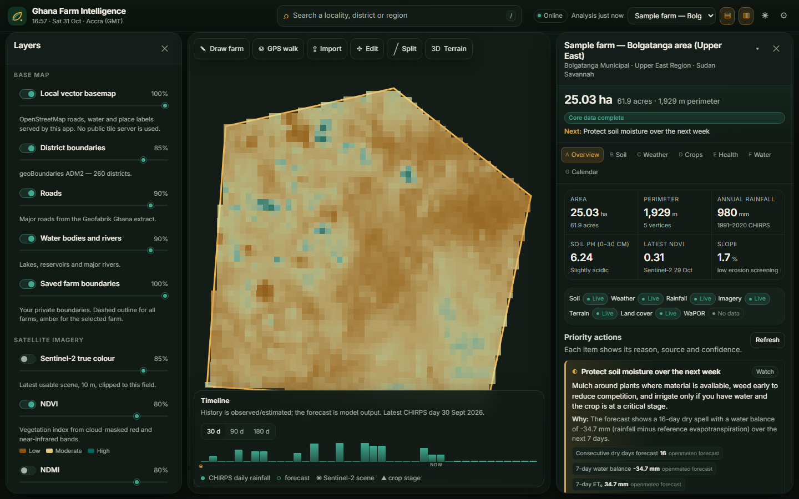
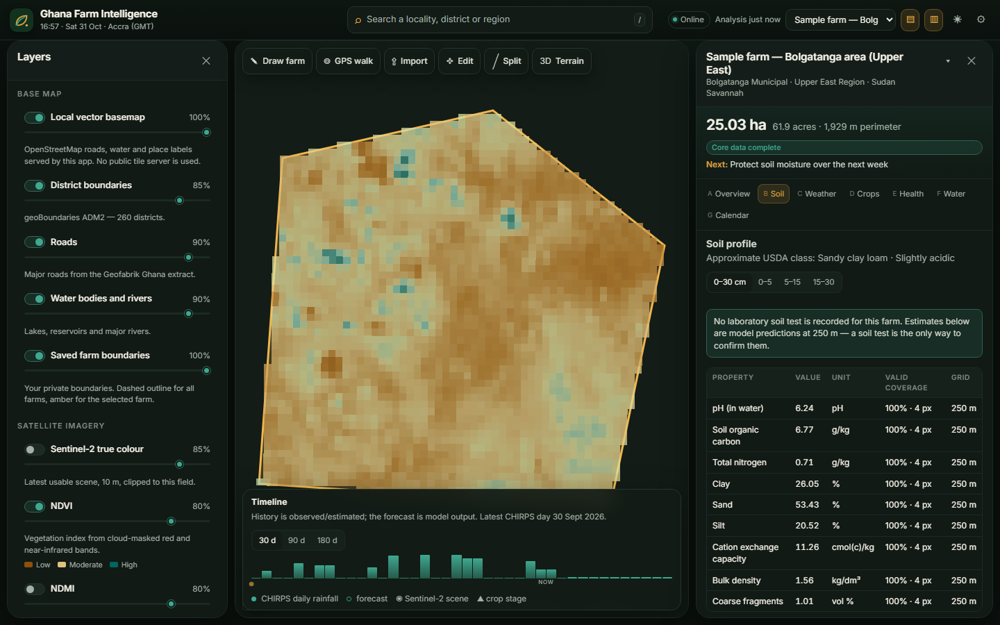
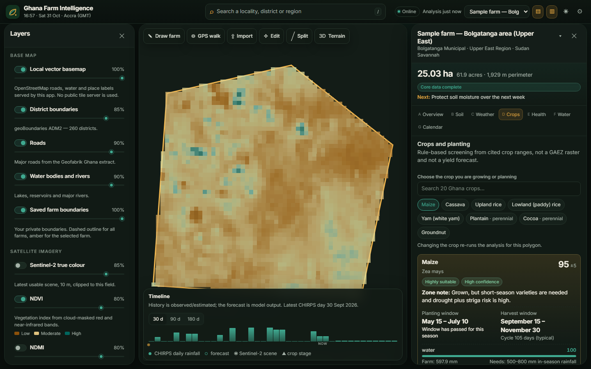
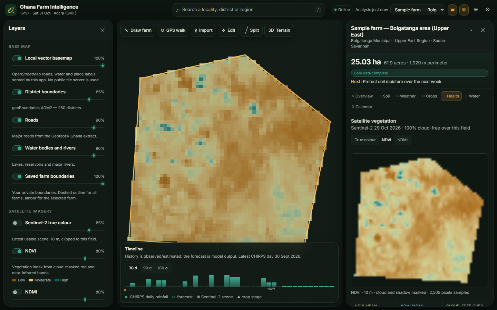
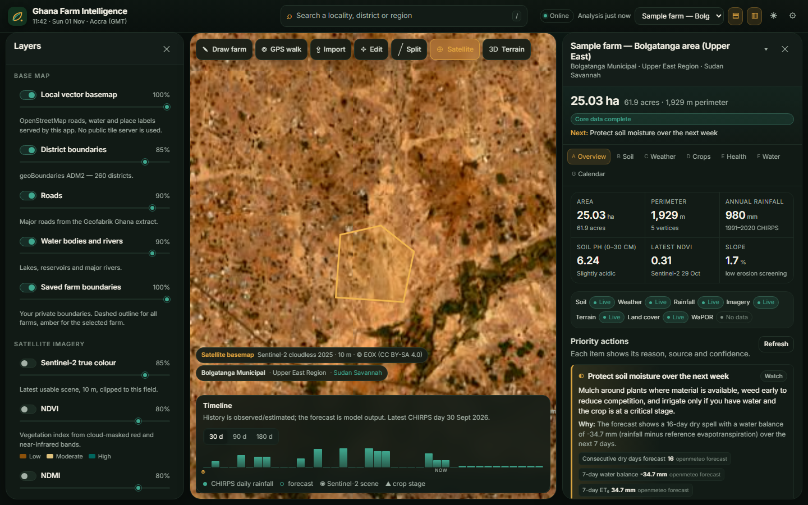

# Ghana Farm Intelligence

A working, locally runnable, mobile-first web application for farm-level intelligence in Ghana.
Locate a farm → draw or import its boundary → get **real, sourced** soil, weather, rainfall,
satellite and terrain data for that polygon → act on evidence-based recommendations.

Built to the specification in `Ghana_Farm_Intelligence_Build_Prompt.md`.



---

## What is real in this build

| Capability | Status | Source | Resolution |
|---|---|---|---|
| Soil profile (pH, SOC, N, texture, CEC, bulk density, coarse fragments, uncertainty) | **Live** | ISRIC SoilGrids 2.0 via WebDAV/VRT | 250 m |
| 16-day forecast, current conditions, ET₀, soil moisture | **Live** | Open-Meteo (`best_match`) | ~11 km grid |
| Daily/monthly rainfall, 30/90-day totals, anomaly vs 1991–2020 | **Live** | CHIRPS v2.0 (Digital Earth Africa COG mirror) + bundled climatology | 0.05° (~5.5 km) |
| NDVI, NDMI, true colour, cloud-free fraction, within-field pattern | **Live** | Sentinel-2 L2A COGs (AWS Open Data, Element84 STAC) | 10 m / 20 m |
| Elevation, slope, aspect, erosion screening | **Live** | Copernicus DEM GLO-30 | 30 m |
| Land-cover context (2021 baseline) | **Live** | ESA WorldCover v200 | 10 m |
| Administrative regions/districts, local place search, vector basemap | **Live, self-hosted** | geoBoundaries + Geofabrik OSM extract | Vector |
| Crop reference database and rule-based suitability | **Live, cited** | FAO EcoCrop, FAO crop calendar, FAO-56, MoFA, GIEWS, ICCO | Crop-level ranges |
| WaPOR evapotranspiration | **Unavailable** (FAO API returned HTTP 502 at verification) | — | — |
| GAEZ suitability rasters | **Not connected** (no machine API for polygon subsets) | — | — |
| GMet official advisories | **Manual, source-linked** (no machine API found) | Admin workflow | Regional |
| Market prices / pest alerts | **Administrator-entered only** (no verified price feed) | Admin workflow | District |

Nothing is silently substituted. When a provider fails, the section states that it is unavailable
or shows the last successful values with their original dates.

## Quick start (Docker Compose)

```bash
cp .env.example .env          # optional: set GFI_ADMIN_TOKEN
docker compose up --build
# open http://localhost:8000
```

The image builds the React PWA and serves it from FastAPI on one port. SQLite and provider caches
live in the `gfi-data` volume.

## Quick start (no Docker)

Requirements: Python 3.12+, Node 20+.

```bash
# backend
python -m venv .venv && . .venv/Scripts/activate     # Windows: .venv\Scripts\activate
pip install -r backend/requirements.txt              # or backend/requirements.lock to reproduce exactly
cd backend && uvicorn app.main:app --host 0.0.0.0 --port 8000

# frontend (second terminal)
cd frontend
npm install
npm run dev            # http://localhost:5173, proxies /api to :8000
```

For a production-style single-origin run without Docker:

```bash
cd frontend && npm run build
cd ../backend && GFI_STATIC_DIR=../frontend/dist uvicorn app.main:app --host 0.0.0.0 --port 8000
```

### Deploying to Railway

See [`docs/DEPLOY_RAILWAY.md`](docs/DEPLOY_RAILWAY.md). The short version: deploy this repository
as a Docker service, mount a volume at `/data`, set `GFI_DATA_DIR=/data`, keep **one replica**, and
optionally set `GFI_ADMIN_TOKEN`. `railway.json` supplies the healthcheck (`/api/health`).

## The interaction that matters

1. **Locate** — search the local OSM index (9,774 places plus 16 regions and 260 districts), use GPS,
   enter coordinates, or click the map.
2. **Draw** — tap vertices, drag vertices, undo/redo, snap to existing corners, close by tapping the
   first point. Or import GeoJSON/KML/GPX and split a farm into fields along a drawn line.
3. **Measure** — the backend computes the **true geodesic area** (WGS84 ellipsoid), perimeter,
   centroid and bbox, rejects self-intersections, polygons outside Ghana, sub-50 m² slivers and
   oversized boundaries, and warns about overlap with other saved farms.
4. **Analyse** — the moment a farm is selected, a background job queries every available provider
   *for that polygon*: raster windows are masked with the polygon, statistics are area-weighted,
   valid-pixel fractions are recorded, and each section carries its own provenance.
5. **Act** — the overview shows the top three actions. Every recommendation exposes its rule,
   evidence values, sources, confidence and limitations.





## Features

### Mapping and boundaries
- MapLibre GL JS with a **self-hosted** vector basemap built from the Geofabrik Ghana extract
  (roads, water, place labels, district boundaries). No tiles are fetched from
  `tile.openstreetmap.org`; no public tile server is prefetched.
- Draw, edit vertices, move, undo/redo, split into fields, rename, delete, import GeoJSON/KML/GPX,
  GPS boundary walking with accuracy display, keyboard shortcuts (`/`, `d`, `e`, `g`, Esc).
- Optional 3D terrain from Mapzen/AWS terrarium tiles, off by default for slow devices.
- Several farms and several fields per farm; multi-part boundaries supported.

### Map layers
- Self-hosted vector basemap (no public tile server), districts, roads, water and saved farms.
- On-demand evidence layers rendered from the **same polygon-masked rasters as the report**, clipped
  to the selected boundary and cached: Sentinel-2 true colour/NDVI/NDMI, soil pH, soil organic carbon,
  clay (250 m), WorldCover land cover (10 m), slope and elevation (30 m).
- Each layer ships a legend, a native-resolution statement and a value range; a 25 ha field really does
  show about four 250 m soil cells, and the panel says so.
- **Satellite button** switches the **whole basemap** to the Sentinel-2 cloudless 2025 mosaic
  (EOX, 10 m, CC BY-SA 4.0) at any pan or zoom, and back to the vector map. It opens at a regional
  zoom because the annual mosaic is soft at field scale; the latest individual scene stays in the
  Sentinel-2 tab. No Google/Esri tiles.



### Farm intelligence panel (seven tabs)
- **Overview** — area, perimeter, zone, crop, data-coverage chips, top three actions, farm facts.
- **Soil** — 0–30 cm profile and per-depth values, USDA texture class, pH interval, uncertainty,
  measured-vs-modelled precedence, explicit "not a lab test" limitations.
- **Weather** — current conditions, 10-day outlook, dry-spell/heat/heavy-rain signals, 7/30/90-day
  rainfall with 1991–2020 anomaly, daily chart, official advisories.
- **Crops** — 20 Ghana crops; rule-based ranking only when at least three components are available;
  per-crop deciding factors, constraints, planting/harvest windows, zone notes, cited sources.
  Perennial crops (cocoa, oil palm, cashew, plantain) are never treated as one-season crops.
- **Crop health** — true colour, NDVI, NDMI chips for the field, cloud-free fraction, scene history,
  within-field low-vigour pattern by quarter (cause explicitly unknown).
- **Water & land** — rainfall/ET₀ balance, soil moisture, 30/90-day anomalies, slope/elevation/
  aspect and erosion screening, 2021 land-cover fractions, honest WaPOR unavailable state.
- **Calendar** — stages with dates, tasks, alerts, farm records, exports.

### Honesty mechanics
- Every section has `status` (`ok`/`stale`/`unavailable`/`error`), `retrieved_at`, sources with
  licence, resolution, method and limitations.
- SoilGrids values are shown only where the 250 m grid has predictions; gaps (for example built-up
  land) produce "no prediction", not a nearby value.
- NDVI/NDMI use only cloud- and shadow-free pixels; the cloud-free fraction over the field is shown.
- Rainfall totals always end on the **latest published CHIRPS day**, with the lag stated.
- Live OSM weather is a model grid cell; its grid coordinates and distance from the centroid are shown.
- Crop suitability is "screening, not a yield forecast"; score categories are capped by data confidence.

### Offline and PWA
- Installable PWA, app-shell precache, cached basemap/catalogue responses.
- IndexedDB stores farms, records and computed analyses; reopening offline shows saved data with an
  offline banner, labelled as saved.
- Service worker never caches analysis POSTs or prefetches OSM tiles.

### Accessibility and mobile
- Keyboard access, visible focus rings, ARIA labels on map tools and panels, screen-reader status
  regions for analysis progress and toasts, reduced-motion support, forced-colors fallbacks.
- Colour-blind-safe NDVI/NDMI ramps, non-colour cues (icons and text) for statuses.
- Daylight high-contrast theme for outdoor use; 390 × 844 phone layout with bottom sheets and
  ≥36 px touch targets.

## API (selected)

```
GET  /api/health                      service + database status
GET  /api/meta                        app metadata, Ghana bounds, languages
GET  /api/catalog/providers           typed provider registry + last health check
GET  /api/catalog/crops               20 crop reference records with sources
GET  /api/places/search?q=tamale      local OSM place/district/region search
GET  /api/places/reverse?lat&lon      nearest place + district
GET  /api/geo/boundaries/ADM1|ADM2    self-hosted boundary GeoJSON
GET  /api/basemap/roads|water|places  self-hosted basemap layers
POST /api/geometry/validate           geodesic area, validation, overlaps, location
POST /api/geometry/split              split a polygon by a drawn line
POST /api/farms                       create a farm (validated, geodesic measurements)
POST /api/farms/sample                clearly labelled sample boundary
POST /api/farms/import                multipart GeoJSON/KML/GPX import
POST /api/farms/{id}/analysis         start analysis job (or return cached)
GET  /api/jobs/{job_id}               progress, partial sections, final payload
GET  /api/farms/{id}/analysis/latest  last completed analysis
POST /api/farms/{id}/soil-tests       record measured laboratory soil data
POST /api/farms/{id}/records          observations, actions, visits
GET  /api/farms/{id}/export?format=geojson|kml|csv|pdf
GET  /api/docs                        OpenAPI UI
```

Administrator routes (`/api/admin/*`, `/api/market-prices`) require `X-Admin-Token` when
`GFI_ADMIN_TOKEN` is set. Set `GFI_ACCESS_TOKEN` to gate the private API behind one shared secret, or —
for real accounts — set `GFI_ADMIN_USER` and `GFI_ADMIN_PASSWORD` once to create the first administrator,
who then creates every other account (with an administrator flag) in **Settings → Accounts**. Each account
sees only the farms it created; administrators see all of them. With no accounts and no token, a deployment
is open, which is the documented local default.

### Stale interface after an update

The app is a PWA and can keep serving an older bundle. Open **Settings → General → App version**; the
build timestamp is shown there. Use **Reload app & clear cache** once — it unregisters the service
worker and clears caches but keeps saved farms in IndexedDB. A Railway deployment must be redeployed;
pushing source changes does not update a running image.

## Tests
```bash
# deterministic unit + API tests (no network): 32 unit + 15 API
cd backend && python -m pytest tests -q                   # 47 passed, 11 live skipped

# live provider integration tests (network)
GFI_LIVE_TESTS=1 python -m pytest tests/test_providers_live.py -q   # 11 passed
# southern + northern farms against SoilGrids, Open-Meteo, CHIRPS, Sentinel-2, DEM;
# includes a 30-year CHIRPS climatology vs raw COG cross-check and a WaPOR
# "must report unavailable, never fake a value" assertion.

# browser acceptance tests (app must be running on :8000)
cd frontend && npm ci && npx playwright install chromium
GFI_BASE_URL=http://127.0.0.1:8000 npx playwright test --project=desktop
# 8 passed: onboarding, real analysis + provenance + tabs, draw/save/GeoJSON/PDF,
# evidence layers rendered on demand, satellite basemap, locality search, offline reload, mobile viewport
GFI_BASE_URL=http://127.0.0.1:8000 npx playwright test --project=android
# the same 8 passing at a Pixel 5 viewport; the suite is re-runnable against an
# existing database (it selects the sample farm explicitly rather than whatever
# farm happens to be first)
```

Verification run on 31 October 2026: **23 unit + 11 live + 8 browser tests passed**;
`scripts/verify_providers.py` reported 8 of 9 endpoints reachable, with WaPOR returning HTTP 502
(shown as unavailable in the app). Screenshots used above were captured by
`frontend/tests/e2e/flow.mjs` against the real providers.

`.github/workflows/ci.yml` runs the unit + API suite, a production-settings import check, and a
clean `tsc` + `vite build` on every push. The browser suite is not part of CI: it needs a running
server and live provider access.

## Repository layout

```
backend/app/             FastAPI app
  api/                   REST routers (core, farms, admin)
  geo/                   geodesy, raster sampling, admin, place search
  providers/             typed adapters: soilgrids, chirps, openmeteo, sentinel2,
                         terrain, landcover, wapor, registry
  engine/                crop KB access, suitability, recommendations, calendar
  io/                    KML/GPX/GeoJSON import, GeoJSON/KML/CSV/PDF export
  data/                  crop KB, boundary/place/basemap seeds, SoilGrids VRT seed
backend/scripts/         reproducible seed + verification scripts
frontend/src/            React + TypeScript + MapLibre PWA
frontend/tests/e2e/      Playwright acceptance suite + screenshot/perf scripts
docs/                    provider report, attribution, limitations, deployment
```

## Documentation

- [`docs/PROVIDERS.md`](docs/PROVIDERS.md) — source integration report with smoke-test outcomes.
- [`docs/ATTRIBUTION.md`](docs/ATTRIBUTION.md) — licences, attribution text and obligations.
- [`docs/LIMITATIONS.md`](docs/LIMITATIONS.md) — what is unavailable, approximate or unverified.
- [`docs/ARCHITECTURE.md`](docs/ARCHITECTURE.md) — data model, analysis pipeline, caching, jobs.
- [`docs/DEPLOY_RAILWAY.md`](docs/DEPLOY_RAILWAY.md) — Railway deployment (volume, env vars, HTTPS).
- [`docs/PERFORMANCE.md`](docs/PERFORMANCE.md) — measured load, latency, transfer and frame times.
- [`docs/sample-report.pdf`](docs/sample-report.pdf) — a generated PDF report for the sample farm.
- [`docs/BASEMAP_INGEST.md`](docs/BASEMAP_INGEST.md) — OSM extract procedure.
- [`backend/data/GHANA_CROPS_SOURCES.md`](backend/data/GHANA_CROPS_SOURCES.md) — crop reference sources.

## Licence

Application code: MIT (see `LICENSE`). Datasets retain their own licences; see
[`docs/ATTRIBUTION.md`](docs/ATTRIBUTION.md). Farm boundaries belong to the person who drew them.

## Honest limitations

This is a screening and planning aid. It cannot replace a soil test, field inspection or extension
officer. It does not estimate yields, prices or fertiliser rates, does not diagnose pests or
diseases from imagery, and does not infer land ownership. WaPOR and GAEZ are not connected in this
release, and GMet advice requires administrator entry. See [`docs/LIMITATIONS.md`](docs/LIMITATIONS.md).
